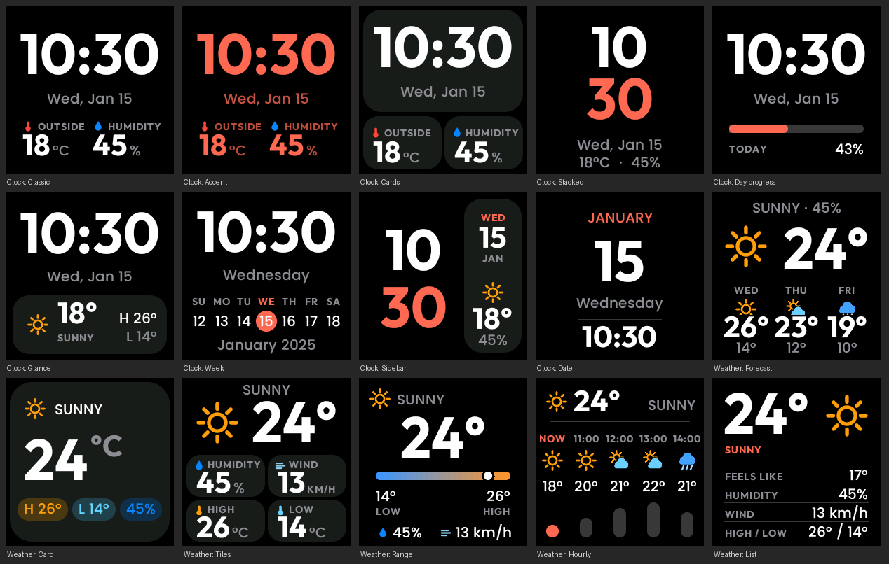

# 📺 GeekMagic Small TV - Custom Modern Firmware

A custom modern firmware specifically designed and tested for the **GeekMagic Small TV** (and Ultra variants) desktop gadgets featuring an ESP8266 processor and a 240x240 ST7789 display.

 

---

## ✨ Features

### 🎨 The Look (Web UI: Display & Faces Tabs)
The web interface is cleanly split between the **Display tab** (for display modes, playlists, and screen settings) and the **Faces tab** (for colors, clock, weather, calendar, and progress styles):
- **Flicker-Free Rendering:** Everything is painted once, and only changed parts are repainted. No flicker or lag.
- **Custom Typography & Icons:** Uses real fonts (Outfit Bold for numbers/labels, Poppins Medium for text) and flat icons (stored compressed at ~24 KB total to save space).
- **Color Customization:** Pick your **accent color** and **time color** via a color box or quick swatches, alongside four base themes (Black, Midnight, Graphite, Light). Includes optional date, info blocks, seconds line, page dots, and 12/24h formats.

### ⏱️ Clock & Weather Faces
- **9 Clock Faces:** Classic, Accent, Cards, Stacked (hours over minutes), Day Progress, Glance (clock + one weather card), Week (clock + 7-day strip), Sidebar (stacked clock + date/weather panel), and Date (the date as the hero). Every face keeps related information grouped together.
- **6 Weather Faces:** Forecast (now + 3 days), Card, Tiles (humidity, wind, high, low), Range (where "now" sits between today's low and high), Hourly (now + next 4 hours with bars), and List (big temperature + labeled rows).
- **Accurate Visuals:** The range marker and hourly bars use the exact same rounded numbers printed on-screen (e.g., a 17° reading between 16° and 18° sits dead center, and equal temperatures produce equal bars).

### 📊 Progress & Countdowns (Faces Tab)
Track time passing or count down to important milestones (repainted once a minute):
- **Watch Boxes:** Three stacked boxes for **Year** (red), **Month** (orange), and **Day** (green)—each showing the percentage, time remaining (days, or hours for the current day), and a progress bar. Choose between *solid* or *tinted* boxes, customize all three colors, and toggle percentages between "done" and "left".
- **Dots:** A visual grid displaying one square per day of the year, day of the month, or hour of the day (selectable between Day, Month, or Year).
- **Countdowns:** Track up to **4 custom events** (name, date, time, and optional "count from" start date) across four styles:
  - **Big:** A huge number that fills the screen.
  - **Sentence:** Natural phrasing (e.g., *"10 days are left for the exam"*, *"One day is left for my flight"*, *"Today is..."*, or *"5 days have passed since..."*).
  - **Boxes:** Days, hours, and minutes displayed in the three custom colors.
  - **Bar:** A visual progress bar tracking time since your start date.
- **Flexible Display:** Show it via the **Progress** button, the Progress checkbox under Pages, "Progress only" mode, or as a custom playlist item targeting a specific period or event.

### 📅 Calendar 
A dedicated month calendar page with three distinct styles: **Month Grid**, **Tiles**, and **Focus** (big day number + small month).
- **Customization:** Choose a Monday or Sunday start, pick a custom weekend color, and dim days from neighboring months.
- **Header Clock:** Includes a small clock in the header and highlights today's date in your accent color. Show it via the Calendar button, page rotation, "Calendar only" mode, or inside a playlist.

### ⏳ Timer & Stopwatch (Timer Tab)
Take over the screen when you need to focus or track time:
- **Timer:** Start a countdown (use presets or custom minutes/seconds up to `99:59`) with Pause/Resume and Cancel. When a timer finishes, the screen flashes for up to a minute.
- **Stopwatch:** Features Start, Stop, Lap (displays the last 3 laps), and Reset. 
- Click **"Back to the normal display"** at any time to return to your regular pages or playlist.

### 🔀 Multiple Playlists (Custom Rotation)
Set your Display Mode to **Custom Playlist** in the Display tab:
- **Up to 4 Playlists:** Maintain up to four separate, renameable playlists with up to 10 items each. Switching between playlists is instant and costs zero performance.
- **Granular Control:** Every item has its own page (Clock, Weather, Status, GIF, Calendar, or Progress), a specific face/event for that page, and a custom duration in seconds.
  - *Example Playlist 1:* GIF (20s) ➔ Clock Date (20s).
  - *Example Playlist 2:* Clock Glance (10s) ➔ Weather Hourly (5s) ➔ Weather Range (5s).
- **Smart Home Integration (MQTT):** Publish `1`–`4` to `<topic>/playlist/set` via Home Assistant / MQTT to switch the active playlist remotely. (Standard even-rotation and single-page modes are also available).

### 🎬 GIF Support
- **Upload & Play:** Upload as many GIFs as fit in memory. Pick one with **Use**, or press **Next GIF** to cycle through them alphabetically.
- **Auto-Play / Loop:** Enable **Play all GIFs in turn** (GIFs tab) to automatically switch to the next GIF at the end of a loop once your chosen duration has elapsed.
- **Smart Looping:** Loops maintain the GIF's native pacing, and the first frame is drawn in a single streamed pass to minimize pause at the loop point.
- **Smart Home Integration (MQTT):** Publish anything to `<topic>/gif/next` via Home Assistant / MQTT to skip to the next GIF.

---

## 🚀 Installation (WiFi Only, OTA)

### Why Two Files? (Memory Safety)
The original firmware's updater only has room for a new firmware of about **524 KB**. To prevent `"ERROR[4] Not Enough Space"`, updating uses a two-step process:
1. **`SmallTV-Installer.bin`** (small) is flashed first via the original update page.
2. **`SmallTV-Modern.bin`** (full) is flashed through the installer's page, which allocates more room.

*Note: The build script strictly verifies each binary's size against the exact limit of the upload page and fails with a clear message rather than producing an oversized file. Unused OTA libraries and built-in fonts have been stripped out to maximize free space.*

### Step-by-Step Guide

1. **Get the files:** Upload this repository to GitHub (keeping `.github`) and download the `SmallTV-bins` artifact from the **Actions** tab, or build locally by running `pio run`.
2. **Flash the Installer:** Open `http://<device-ip>/update` on your stock firmware. Under *Firmware* (not FileSystem), select **`SmallTV-Installer.bin`** and press Update. Wait ~1 minute. Do not unplug. (A blank or white screen is normal at this step).
3. **Connect to the Installer:** The installer automatically imports your stock WiFi credentials. Look for `smalltv-installer` on your router. If it can't connect, join the `SmallTV-Installer-XXXXXX` WiFi hotspot from your phone, open `192.168.4.1`, and enter your WiFi details.
4. **Flash the Custom Modern Firmware:** Open the installer's IP address, click **Open the upload page**, select **`SmallTV-Modern.bin`** under *Firmware*, and press Update.
5. **Setup:** Open the IP address shown on the device screen (Status page) or visit `http://smalltv.local` to configure your location, time zone, and display styles.

---

## 🔄 Updates & Maintenance

### Updating to Newer Versions
Because the full firmware is too large to overwrite itself directly:
1. Open `http://<device-ip>/update` and upload `SmallTV-Installer.bin`.
2. Wait for it to reboot, open the installer's address, click **Open the upload page**, and upload the new `SmallTV-Modern.bin`. 
*(All your settings and uploaded GIFs are preserved).*

### Reverting to Original Stock Firmware
Follow the exact same two-step update process, but upload the original `FW-Smalltv-Ultra-V9_0_50.bin` from the installer's upload page. This firmware never formats the stock filesystem and stores its configuration separately in `smalltv_cfg.json`.

### 🛡️ Safety Net & Recovery
- **Recovery Mode:** 3 consecutive restarts without reaching 3 minutes of uptime automatically launches a minimal recovery mode (WiFi + upload page, blinking backlight). You can trigger this manually by pressing reset 3 times quickly, then uploading `SmallTV-Installer.bin`.
- **Limitations:** Power loss during
