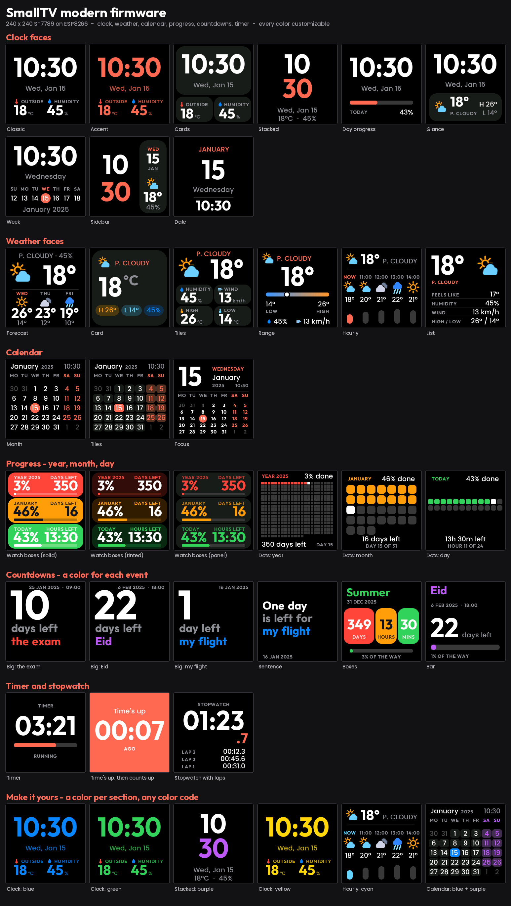

# SmallTV modern firmware (ESP8266, 240x240 ST7789)

*Every screen above is rendered by the firmware's own drawing code (see `ui-preview.png`).*

**Status: written but NOT compiled for the device or tested on hardware.** The drawing and screen code was compiled and run on a
computer against a fake display (that is what `ui-preview.png` shows), but the rest still needs a real build. Expect to fix small
build errors, and check the pin table below.

## Why two files?
The original firmware's updater only has room for a new firmware of about **524 KB**. So **SmallTV-Installer.bin** (small) goes on
first through the original update page, then **SmallTV-Modern.bin** (full) goes on through the installer's page, which has more room.

## Memory safety ("ERROR[4] Not Enough Space")
The build checks the size of each file against the exact limit of the page it will be uploaded through, and **fails with a clear
message instead of producing a file that would not fit**. The log shows e.g. `SmallTV-Modern.bin: 612345 bytes. Limit ... (80 KB to
spare)`. The installer page also shows "Largest file accepted now: X KB". Fonts and icons are stored compressed (~24 KB in total),
and the unused OTA library and built-in fonts were removed, so this version is smaller than the previous one.

## Get the files
Upload this folder to GitHub (keep `.github`). The **Actions** tab builds both files; download the artifact `SmallTV-bins`.
Or run `pio run` locally.

## Install (WiFi only, no wires)
1. Open `http://<device-ip>/update` (original firmware). Under *Firmware* (not FileSystem) pick **SmallTV-Installer.bin**, press Update.
   Wait about a minute. Do not unplug. The screen may go blank or white: normal at this step.
2. The installer borrows the original firmware's WiFi login. Look for `smalltv-installer` in your router's list. If it can't join, it
   opens a WiFi network `SmallTV-Installer-XXXXXX`: join it from your phone, open `192.168.4.1`, and enter your WiFi.
3. Open the installer's address, click **Open the upload page**, pick **SmallTV-Modern.bin** under *Firmware*, press Update.
4. Open the address shown on the screen (Status page) or `http://smalltv.local`, set location, time zone and style.

## The look (web UI: Display tab for modes/playlists/screen, Faces tab for colors, clock, weather and calendar)
- **Clock faces (9):** Classic, Accent, Cards, Stacked (hours over minutes), Day progress, Glance (clock + one weather card),
  Week (clock plus a seven-day strip), Sidebar (stacked clock + date/weather panel) and Date (the date as the hero).
  Every face keeps related information together in one group.
- The range marker and the hourly bars use the same rounded numbers that are printed on screen, so a 17° reading between 16° and 18°
  sits exactly in the middle and equal temperatures give equal bars.
- **Weather faces (6):** Forecast (now + three days), Card, Tiles (humidity, wind, high, low), Range (where "now" sits between
  today's low and high), Hourly (now + next four hours with bars) and List (big temperature, then labelled rows).
- **Colors:** four themes (Black, Midnight, Graphite, Light), a **main accent**, a **time color**, and **its own accent for each section**
  (clock, weather, calendar, timer/stopwatch; pick one or press "Main accent" to follow the main one). Progress has its own year /
  month / day colors and every countdown event has its own color. Every color box has a **color-code box** where you can type
  `#RRGGBB`, plus quick swatches. Optional date, info blocks, seconds line, page dots, 12/24 h.
- **Display mode:** rotate through pages or keep one page on screen. No header bar.
- Text uses real fonts (Outfit Bold for numbers and labels, Poppins Medium for text) with flat icons. Everything is painted once and
  then only changed parts are repainted, so there is no flicker or lag.

## Progress and countdowns (Faces tab)
- **Watch boxes:** three stacked boxes - **year** (red), **month** (orange) and **day** (green) - each with the percentage, what is
  left (days, or hours for the day) and a progress bar. Three looks: *solid* colored boxes, *tinted* boxes, and *panel* (a neutral
  box like the Cards clock, with only the text and the bar colored). Choose all three colors yourself and switch the percentage
  between "done" and "left".
- **Dots:** one square per day of the **year** (22 x 17 squares that fill the screen), per day of the month, or per hour of the day.
- **Countdowns:** enter up to four events (name, date, time, optional "count from" date, and **a color for each event**) and show
  them as **Big** (a huge number that fills the screen), **Sentence** ("10 days / are left for / the exam", "One day is left for my
  flight", "Today is ...", "5 days have passed since ..."), **Boxes** (days / hours / minutes) or **Bar** (progress since you started).
  Type the name as it should read in the sentence, e.g. "the exam". Names use English letters, digits and basic punctuation.
Show it with the **Progress** button, the Progress checkbox under Pages, "Progress only", or as a playlist item (an item can pick the
period or the event, so a playlist can run through several events, each in its own color). Everything is repainted once a minute.

## Calendar
A month calendar page with three styles (Month grid, Tiles, Focus = big day number + small month) and its own options in the
Display tab: week starts on Monday or Sunday, weekend coloring with your own weekend color, dimmed days of the neighbouring months,
and a small clock in the header. Today is highlighted in your accent color. Show it with the **Calendar** button, the Calendar
checkbox under Pages, "Calendar only", or as an item in the playlist.

## Timer and stopwatch (Timer tab)
Start a countdown (presets or any minutes/seconds up to 99:59) with Pause/Resume and Cancel, or a stopwatch with Start, Stop, Lap
(the last three laps are shown) and Reset. They take over the screen while they run, in their own color. When a timer ends the
screen flashes "Time's up" for a minute and **keeps counting how long ago it ended** (00:07 ago, 03:20 ago, ...) until you press
"Back to the normal display" (or after an hour).

## Playlists (custom rotation)
Set **Display mode** to **Custom playlist** (Display tab). You can keep **up to four playlists** (rename them, 10 items each) and switch
between them: pick a playlist tab, edit its items, then press **Save and play this playlist**. Every item has a page (Clock, Weather,
Status, GIF, Calendar), a face for that page and its own number of seconds. Example: playlist 1 = GIF + Date for 20 s each, playlist 2 =
Clock Glance 10 s + Weather Hourly 5 s + Weather Range 5 s. Playlists are only settings, so switching costs no performance.
Home Assistant / MQTT: publish 1 to 4 to `<topic>/playlist/set` to play that playlist. A GIF item is skipped if no GIF is selected.
The older modes still work (rotate pages evenly, or keep one page).

## GIFs
- Upload as many as fit; pick one with **Use**, or press **Next GIF** to skip to the next one (alphabetical, wraps around).
- **Play all GIFs in turn** (GIFs tab): switches to the next GIF at the end of a loop once the chosen number of seconds has passed.
- Home Assistant / MQTT: publish anything to `<topic>/gif/next` to skip to the next GIF.
- Loops keep the GIF's own pace and the first frame is drawn in one streamed pass, so the pause at the loop point is much shorter.

## Updating later
The full firmware is too big to replace itself: open its `/update`, upload **SmallTV-Installer.bin**, wait, open the installer's
address, **Open the upload page**, upload the new **SmallTV-Modern.bin**. Settings and GIFs are kept.

## Going back to the original
Same steps, but send the original `FW-Smalltv-Ultra-V9_0_50.bin` from the installer's upload page. This firmware never formats the
original's files; it uses its own settings file (`smalltv_cfg.json`).

## Home Assistant / MQTT commands
Publish to `<your topic>/...`: `page/set` = 0 Clock, 1 Weather, 2 Status, 3 GIF, 4 Calendar, 5 Progress (works for every page, not only the
ones ticked under Pages); `playlist/set` = 1 to 4; `gif/next` = any message; `brightness/set` = 0 to 100.

## Safety net
- **Recovery mode:** 3 restarts in a row without running for 3 minutes starts a minimal mode (WiFi + upload page, backlight
  blinking). Press reset 3 times quickly to trigger it by hand. Upload SmallTV-Installer.bin there.
- Still possible: power loss during an update's final copy can corrupt the image (needs a serial flash); a crash only after 3+
  minutes of uptime does not trigger recovery mode; no password on the web pages.
- A wrong pin setting is harmless: the screen may be blank, but WiFi and the web page still work.

## Hardware values to verify (unverified guesses)
| Item | Used | Where |
|---|---|---|
| Display | ST7789 240x240 | `platformio.ini` |
| MOSI / SCLK | GPIO13 / GPIO14 | fixed on ESP8266 |
| DC / RST | GPIO0 / GPIO2 | `platformio.ini` |
| CS | none (tied low) | |
| Backlight | GPIO5, active low | `src/settings.h` |

Swapped red/blue: add `-DTFT_RGB_ORDER=TFT_BGR`. Inverted colors: add `-DTFT_INVERSION_ON`.
Garbled GIF colors: change `LITTLE_ENDIAN_PIXELS` to `BIG_ENDIAN_PIXELS` in `startGif()`.

## Notes
- Weather (Open-Meteo, no key) uses plain HTTP to save RAM. If it says "Needs HTTPS", uncomment `-DWEATHER_HTTPS=1`.
- The original firmware's GIFs are read from `/image` (and `/gif`). The stock WiFi file format (`{"a":ssid,"p":password}`) was inferred
  from the binary, so the automatic import is best-effort.
- The web UI is embedded in `src/webui.h`. `src/fonts.h` and `src/icons.h` are generated files (compressed 4-bit alpha).
- Fonts: Outfit Bold (The Outfit Project Authors) and Poppins Medium (Indian Type Foundry), both under the SIL Open Font License 1.1.
